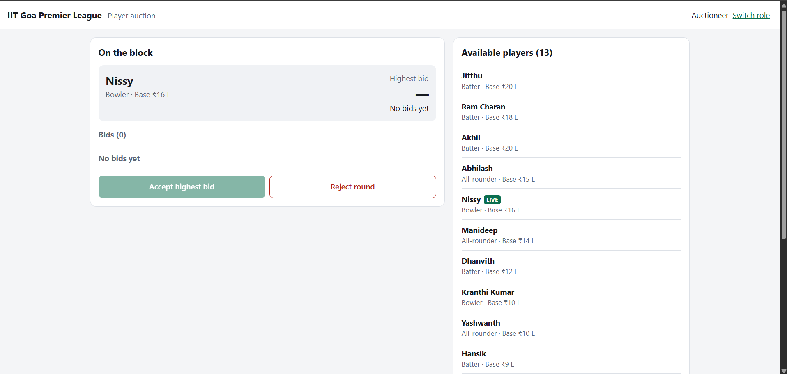
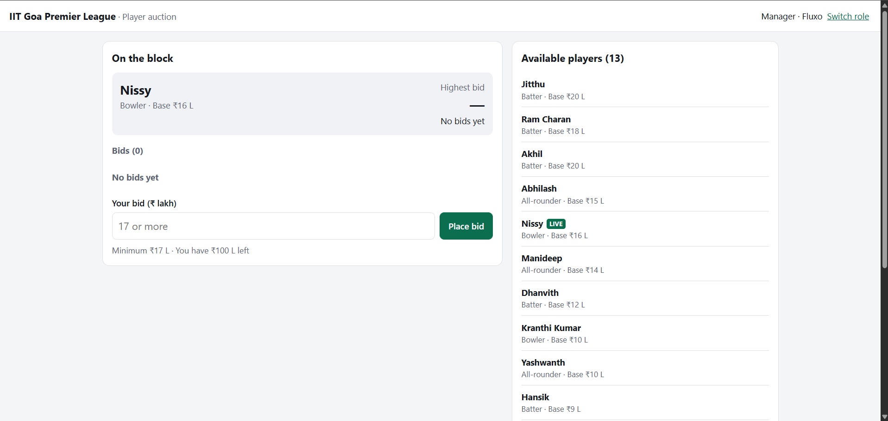
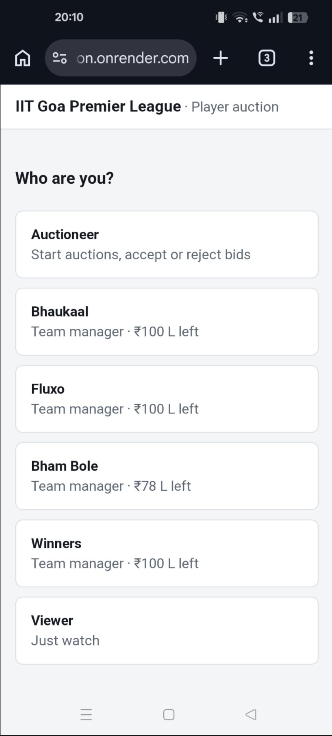
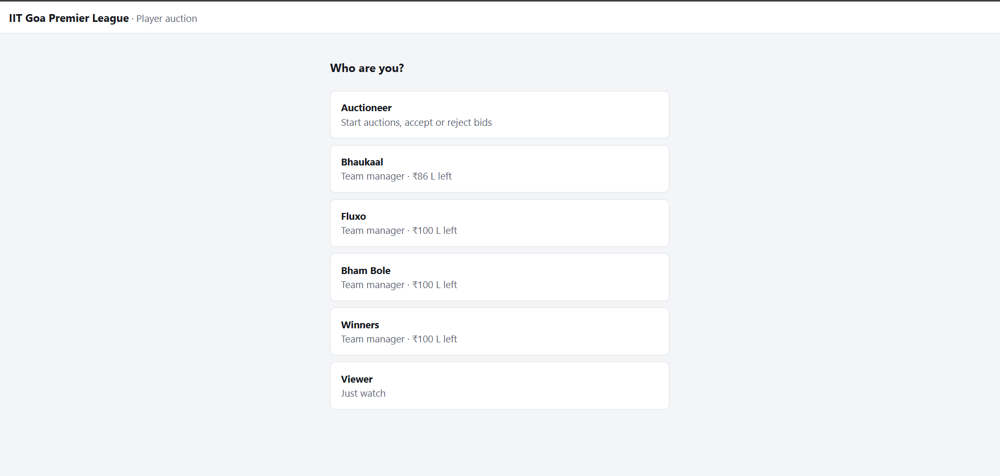

# GPL Auction

Player auction app for the IIT Goa Premier League. Four team managers bid on one player at a time, and the auctioneer accepts the highest bid or rejects the round.

Built with Node.js, Express, and SQLite (Node's built-in `node:sqlite`). The frontend is a single HTML page with plain JS.



## Running

Needs Node.js 22.13 or newer.


Open https://web-auction.onrender.com/. The database file `gpl.db` is created on first run with 4 teams and 14 players. Delete it to start over.

Tests:

```
npm test
```

On the first screen you pick a role (auctioneer, one of the 4 team managers, or viewer). There's no login. To try a full auction, open a few tabs. You can also pick the role from the URL:

- `/?role=auctioneer`
- `/?role=manager&team=1` (team 1 to 4)
- `/?role=viewer`

The page refreshes data from the server every 2 seconds, so all tabs stay in sync.

## Budgets and rules

All amounts are whole numbers in lakhs (₹ L). Every team starts with **₹100 L**:

| id | Team |
|----|------|
| 1 | Bhaukaal |
| 2 | Fluxo |
| 3 | Bham Bole  |
| 4 | Winners |

Players' base price is between ₹5 L and ₹20 L.

Bid rules:

- Only team managers can bid, and only while a player is up for auction.
- The bid must be **more than the base price** and **more than the current highest bid**.
- A team **can't bid twice in a row**. If it already has the highest bid, it has to wait for another team.
- The bid **can't be more than the team's remaining budget**. Bidding exactly the remaining budget is allowed.
- A bid that breaks any rule is not saved.

Auctioneer rules:

- Only one player can be up for auction at a time, and a sold player can't be put up again.
- **Accept** sells the player to the highest bidder. The player's status becomes `sold`, they go on that team's roster at the bid price, and the price is taken off the team's remaining budget. You can't accept a round with no bids.
- **Reject** puts the player back as `available`. Their bids from that round are deleted, so if they're put up again, bidding starts from the base price.

## API

All endpoints are under `/api` and return JSON. Errors look like this:

```json
{ "error": "Not enough budget: Bhaukaal only has 54 left" }
```

Since there's no real login, the frontend sends the chosen role in headers:

- `X-Role`: `auctioneer` or `manager`
- `X-Team`: the team id (managers only)

Any route can also return `400 Invalid JSON` if the body can't be parsed, or `500` on a server error.

### GET /api/state

Everything the page needs: all players, all teams with rosters, and the current auction (`null` if none).

Response `200`:

```json
{
  "players": [
    { "id": 1, "name": "Jitthu", "skill": "batting", "base_price": 20, "status": "sold", "sold_price": 34, "team_id": 1 }
  ],
  "teams": [
    { "id": 1, "name": "Fluxo", "total_budget": 100, "remaining_budget": 66,
      "players": [{ "id": 1, "name": "Jitthu", "skill": "batting", "sold_price": 34 }] }
  ],
  "auction": {
    "player": { "id": 5, "name": "Nissy", "skill": "both", "base_price": 15, "status": "in_auction", "sold_price": null, "team_id": null },
    "bids": [
      { "id": 9, "player_id": 5, "team_id": 3, "team_name": "Bham Bole", "amount": 24, "time": "2026-10-07T10:15:30.000Z" }
    ],
    "highest": { "id": 9, "player_id": 5, "team_id": 3, "team_name": "Bham Bole", "amount": 24, "time": "2026-10-07T10:15:30.000Z" }
  }
}
```

`bids` is sorted highest first.

### GET /api/players

Lists players. The optional `?status=available|in_auction|sold` filters them.

Response `200`: an array of players, in the same shape as above.

### GET /api/teams

Lists the teams with their budgets and rosters.

Response `200`: an array of teams, in the same shape as above.

### POST /api/auction/start

Puts a player up for auction. Auctioneer only.

Headers: `X-Role: auctioneer`
Body: `{ "playerId": 5 }`
Response `201`: the current auction (`{ player, bids, highest }`)

| Status | Error |
|--------|-------|
| 403 | Only the auctioneer can do this |
| 404 | Player not found |
| 409 | Another player is already up for auction |
| 409 | `<name>` is already sold |

### POST /api/auction/bid

Places a bid for the manager's team on the player currently up for auction.

Headers: `X-Role: manager`, `X-Team: 3`
Body: `{ "amount": 25 }`
Response `201`: the updated auction (`{ player, bids, highest }`)

| Status | Error |
|--------|-------|
| 400 | Bid amount must be a whole number |
| 403 | Only a team manager can bid |
| 404 | Team not found |
| 409 | No player is up for auction |
| 409 | You already have the highest bid |
| 422 | Bid must be more than the base price of `<x>` |
| 422 | Bid must be more than the highest bid of `<x>` |
| 422 | Not enough budget: `<team>` only has `<x>` left |

### POST /api/auction/accept

Sells the current player to the highest bidder. Auctioneer only.

Headers: `X-Role: auctioneer`
Body: none
Response `200`: the sold player, e.g. `{ "id": 5, "name": "Nissy", "status": "sold", "sold_price": 24, "team_id": 3, ... }`

| Status | Error |
|--------|-------|
| 403 | Only the auctioneer can do this |
| 409 | No player is up for auction |
| 409 | There are no bids to accept |

### POST /api/auction/reject

Ends the round without selling. The player goes back to `available`. Auctioneer only.

Headers: `X-Role: auctioneer`
Body: none
Response `200`: the player, with `status: "available"`

| Status | Error |
|--------|-------|
| 403 | Only the auctioneer can do this |
| 409 | No player is up for auction |

There are no WebSockets or SSE. The page polls `GET /api/state`.

## Database schema

SQLite, stored in `gpl.db`. The tables are created in `openDb()` in `server.js`, and foreign keys are switched on.

**teams**

| Column | Type | Constraints |
|--------|------|-------------|
| id | INTEGER | primary key |
| name | TEXT | not null, unique |
| total_budget | INTEGER | not null, > 0 |
| remaining_budget | INTEGER | not null, >= 0 |

**players**

| Column | Type | Constraints |
|--------|------|-------------|
| id | INTEGER | primary key |
| name | TEXT | not null |
| skill | TEXT | not null, one of `batting`, `bowling`, `both` |
| base_price | INTEGER | not null, > 0 |
| status | TEXT | not null, default `available`, one of `available`, `in_auction`, `sold` |
| sold_price | INTEGER | null until sold |
| team_id | INTEGER | foreign key → teams.id, null until sold |

**bids**

| Column | Type | Constraints |
|--------|------|-------------|
| id | INTEGER | primary key |
| player_id | INTEGER | not null, foreign key → players.id |
| team_id | INTEGER | not null, foreign key → teams.id |
| amount | INTEGER | not null, > 0 |
| time | TEXT | not null, ISO timestamp |

## Files

```
server.js          database, auction rules and API routes
public/index.html  the whole frontend (HTML, CSS, JS)
test.js            tests for bid, accept and reject rules
screenshots/
```

## Screenshots

Auctioneer view, with a player on the block and three bids:


Team manager view (Fluxo), with the bid box:



On Phone:



Role picker:


